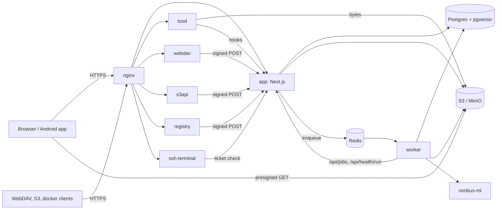

# Architecture

A quick map of how Nimbus is put together: the services it runs, how they talk, and what happens when a file is uploaded, opened or searched. For the full story, with diagrams and the reasons behind each choice, read the [system design guide (PDF)](nimbus-system-design.pdf).

To install Nimbus, see [install.md](install.md). For every setting, see [configuration.md](configuration.md). The Vault and Secrets have their own guides: [vault.md](vault.md) and [secrets.md](secrets.md).

## Overview

Nimbus is one Next.js app (`apps/web`) plus a few small Node processes started from the same image with a different command. Postgres holds every row, S3-compatible storage holds every file's bytes, and Redis holds the job queues. tusd takes resumable uploads straight into the bucket.



## Services

These are the services in the root [docker-compose.yml](../docker-compose.yml). `COMPOSE_PROFILES` in `.env` picks the optional ones. Every port binds to `127.0.0.1`; nginx on the host is the only thing facing the internet.

| Service | Runs | Port | What it does |
|---|---|---|---|
| `app` | always | 3400 | The Next.js web app and API. Does nearly all the real work |
| `worker` | always | none | Runs the background job queues and the health checks (`scripts/worker.ts`). Required |
| `migrate` | always, once | none | Builds the image and applies database migrations, then exits |
| `tusd` | always | 3401 | Resumable uploads (tus protocol) written straight into the bucket |
| `redis` | always | 6340 | Job queues (BullMQ), rate limits and caches |
| `webdav` | always | 3404 | WebDAV at `/dav`. Next can't route WebDAV's methods, so it hands each request to the app as a signed POST |
| `ssh-terminal` | always | 3406 | Browser SSH terminal for Secrets: WebSockets from xterm.js to ssh2 |
| `postgres` | `postgres` | 54340 | `pgvector/pgvector:pg17`. Skip it to use your own Postgres |
| `minio`, `minio-init` | `minio` | 3402 / 3403 | File storage and its console; `minio-init` makes the bucket. Skip them to use your own S3 |
| `backup-worker` | `backup` | none | Admin → Backups. Drives the host's Docker for `pg_dump` and a scratch Postgres to verify each dump |
| `ntfy` | `push` | 3405 | Self-hosted push server for the Android app |
| `s3api` | `s3api` | 3407 | S3-compatible API for aws cli, rclone, restic and Terraform. Hands requests to the app as signed POSTs |
| `registry` | `registry` | 3408 | Container registry for docker, podman, helm and buildx. Layers stream through |
| `registry-scan` | `scan` | none | Trivy behind a small HTTP front, for image scanning |
| `buildkitd`, `build-runner` | `build` | none | Rootless BuildKit in a CPU- and RAM-capped container, and the runner that drives it |
| `ml` | `ml` | none | `nimbus-ml` (`services/ml`, Python): speech to text, photo search and face grouping. CPU only, 3 GB memory cap |

For local development, `local_server/docker-compose.yml` runs Postgres, MinIO, tusd, Redis, Mailpit and, optionally, Collabora and nimbus-ml. Its ports are in [CONTRIBUTING.md](../CONTRIBUTING.md#dev-ports).

## Repo layout

| Path | What it is |
|---|---|
| `apps/web` | The Next.js app (`app/`, `components/`, `lib/`), migrations (`drizzle/`) and the side processes (`scripts/`: worker, webdav, s3, registry, ssh-terminal, backup-worker, indexer) |
| `apps/mobile` | The Android app (Expo) |
| `packages/shared` | Code shared by web and mobile: vault crypto, file rules, API types, photos, comments, PDF annotations |
| `packages/cli`, `packages/cli-go` | The Secrets CLI, in Node and as one Go binary |
| `services/ml` | `nimbus-ml`, the optional AI service |
| `local_server` | Dev services |
| `docker` | Registry scanning and image build images and config |
| `production_script` | nginx templates and `setup-nginx.sh` |

Key files in `apps/web/lib`:

| File | Holds |
|---|---|
| `db/schema.ts` | The whole Drizzle schema |
| `auth.ts` | Better Auth setup: sign-in methods, two-factor, passkeys, device sign-in |
| `redis.ts` | Queue names, `enqueue`, and the job schedules |
| `uploads.ts`, `upload-rules.ts` | Upload tokens and turning a finished upload into a file |
| `extract.ts` | Reading text from files for search, including OCR |
| `vault-crypto.ts` | Vault key handling (with `packages/shared/vault-crypto.ts`) |
| `secrets/kms.ts` | Secrets encryption under `SECRETS_ROOT_KEY` |
| `audit.ts` | `saveSettings()` and the admin audit log |

## Upload

```
browser ──1. upload token──> app
browser ──2. tus PATCH───────> tusd ──3. pre-create hook──> app (token, size, type, quota; reserve space)
                               tusd ──4. parts──────────────> S3
                               tusd ──5. post-finish hook──> app ──> file + version rows in Postgres
                                                                 └─> derive job, leak-scan job (Redis)
```

1. The app signs an upload token naming the member and the target folder (valid 24 hours).
2. The browser sends the file to tusd, three files at a time. Uploads pause, resume and survive a closed tab.
3. tusd's `pre-create` hook asks the app. The app checks the token, the size limit, blocked file types and the quota, and reserves the space. A rejected upload gets the reason back.
4. tusd writes the parts into the bucket. The object exists only once every part has arrived.
5. On `post-finish`, the app turns the upload into a file (or a new version) in Postgres. The browser also calls finish, and finishing is idempotent. If the database is away, a `tus-finish` job retries it. On `post-terminate` (cancelled), the reserved space is freed.
6. The app queues a `derive` job (thumbnail and search text, after two minutes so a browser that's looking gets there first) and, for scannable files, a `leak-scan` job that looks for leaked secrets.

Vault uploads use the same tus path, but each 4 MiB chunk is encrypted in the browser first. See [vault.md](vault.md).

Thumbnails are 480px WebP, stored at `thumbs/<s3Key>.webp`. The browser draws them at upload; the worker's `derive` job makes them for files no browser handled, such as WebDAV and API uploads.

## Download and preview

- **One file:** the app checks access and redirects to a presigned S3 URL. The bytes go from storage to the browser without passing through the app.
- **Folders and selections:** the app streams a store-only ZIP64, with flat memory at any size.
- **Previews:** the previewer fetches presigned URLs straight from the browser, so the bucket needs a CORS rule allowing `GET` from the app and exposing `Content-Range` (zip listings read byte ranges). Images, video, audio, PDF, code, Markdown, CSV, xlsx, docx and pptx have built-in viewers.
- **Office files:** with Collabora set up, they open read-only through two WOPI endpoints with a signed token. Access is rechecked on every call.
- **Vault files:** downloaded as ciphertext and decrypted in the browser as they stream.
- **Video:** the worker can make 720p and 480p data-saver copies (`transcode` queue).

## Search

- **Names:** substring or close spelling, with `pg_trgm` word similarity.
- **Text inside files:** `node_content` keeps the current version's text with a generated `tsvector` and a GIN index. Queries use `websearch_to_tsquery('simple')`, so plain words and "quoted phrases" work.
- **Reading text:** the worker's indexer (`scripts/indexer.ts`, using `lib/extract.ts`) sweeps every minute for files without text: text and code, PDF, docx, sheets, pptx, and OCR for images, scanned PDFs and video frames. `npm run indexer` runs one sweep.
- **AI search (optional):** with `nimbus-ml` running, the worker sends it audio for speech to text, and photos for CLIP image search and face grouping. Vectors live in Postgres with pgvector.
- Search covers a member's own files and what's shared with them. Trash and vaults are never searched.

## Background jobs

Everything slow or retryable goes through BullMQ queues in Redis. The app queues jobs with `enqueue()` in `lib/redis.ts`. For most jobs, the worker only keeps time and retries: it calls back to the app at `POST /api/jobs` with a short-lived signed token, and the app does the work. The indexer, thumbnails and video copies run inside the worker, since they're heavy and native.

| Queue | Consumer | Jobs |
|---|---|---|
| `health` | worker | Admin → Health checks, on the interval the admin picks |
| `jobs` | worker | Scheduled and queued jobs, listed below |
| `derive` | worker | Thumbnails, search text and photo details for one file version |
| `transcode` | worker | Data-saver video copies, one at a time |
| `backups` | backup-worker | Database dumps and file copies, on the admin's schedule |
| `registry-builds` | build-runner | Container image builds |

Scheduled jobs on the `jobs` queue:

| Job | Every | Does |
|---|---|---|
| `index` | minute | Search text sweep, then missing thumbnails, photo details, hashes, documents and video copies; AI sweep in its own lane |
| `purge` | hour | Expired trash, old activity and transfers, junk files |
| `secrets-sweep` | hour | Expired temporary access, rotation reminders, token expiry, spent share links, Secrets trash |
| `registry-trash-purge` | hour | Registry trash past retention |
| `orphan-sweep` | week | Deletes stored objects nothing points at any more |
| `phone-backup-stale` | day | Warns about phones that stopped backing up |
| `documents-remind` | day | Reminders for expiring documents |
| `face-cluster` | day | Groups faces found by nimbus-ml |
| `s3-multipart-stale` | day | Aborts stale S3 API multipart uploads |
| `registry-gc`, `registry-policy`, `registry-rescan`, `registry-uploads-stale`, `registry-aliases-purge`, `registry-events-purge`, `registry-mirror-expire`, `registry-connections-expiry` | day | Registry cleanup, cleanup policies, rescans and expiry warnings |

Jobs queued on demand: `email`, `push`, `delete-keys` (S3 deletes), `tus-finish`, `leak-scan`, `leak-scan-user`, `ocr-langs`, `backup-alert`, `secrets-push`, `secrets-webhook`, `secrets-lease-expire`, `secrets-rotate-root`, `registry-scan`, `registry-advice`, `registry-webhook`, `s3-etags`.

## More

- [System design guide (PDF)](nimbus-system-design.pdf): architecture, data flows, security and crypto, and the trade-offs, in depth.
- [SECURITY.md](../SECURITY.md): reporting a vulnerability and a summary of the security design.
- [ROADMAP.md](../ROADMAP.md): what's built, phase by phase, and what's left for later.
